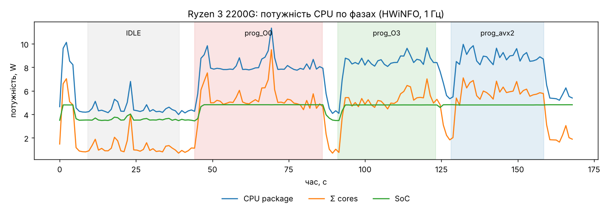

# perf-lab - профілювання, енергоспоживання та оптимізація програми на C

Програма: `src/main.c` - три обчислювальні етапи з різним характером навантаження:

| Етап | Що робить | Характер |
|---|---|---|
| `init_data` | генерує дані (LCG) | скалярний, залежність по `rng_state` |
| `matmul` | C = A·B, float 2048×2048, порядок i-k-j | обчислення + пам'ять, добре векторизується |
| `saxpy_loop` | y = a·x + y, 4M float × 400 повторів | обмежений пропускною здатністю пам'яті |
| `histogram` | гістограма 64 MB байтів | непрямі звернення `hist[b]++`, не векторизується |

Функції позначені `noinline`, щоб кожен етап лишався окремим кадром на FlameGraph навіть при `-O3`.

Збірки (`Makefile`):

| Збірка | Ключі | Роль |
|---|---|---|
| `prog_O0` | `-O0` | «до» оптимізації |
| `prog_O3` | `-O3` | авто-векторизація SSE (128 біт, `xmm`) |
| `prog_avx2` | `-O3 -mavx2 -mfma` | «після»: AVX2 (256 біт, `ymm`) + FMA |

Усі збірки з `-g -fno-omit-frame-pointer`, щоб `perf` коректно розкручував стек.

## Як відтворити

```bash
sudo apt install build-essential linux-tools-generic   # perf
./scripts/run_linux.sh                                 # пп. 1, 2, 4.2, 4.3 → results/
```

Енергія на Windows: завантажити HWiNFO64 portable у `Downloads`, подвійний клік `windows/run_all_energy.bat` → `power.csv`, `phases.csv`; потім
`python3 scripts/energy_from_hwinfo.py results/energy/power.csv results/energy/phases.csv`.

Середовище замірів пп. 1–2: Linux 6.18, Intel Xeon (AVX2/AVX-512), gcc, perf. Це віртуальна машина, тому апаратні лічильники PMU (`cycles`, `instructions`, кеш-міси) гіпервізор не прокидає - `perf stat` показує `<not supported>` (пояснення нижче). Семплювання `perf record` працює через програмний таймер (`cpu-clock`).

---

## 1. FlameGraph

### 1.1 Побудова

```bash
perf record -F 999 --call-graph dwarf -o perf.data ./build/prog_O0   # семпли стеків 999 Гц
perf script -i perf.data > out.perf                                   # текстові стеки
tools/FlameGraph/stackcollapse-perf.pl out.perf > out.folded          # згортка: "a;b;c N"
tools/FlameGraph/flamegraph.pl out.folded > flamegraph.svg            # SVG
```

`--call-graph dwarf` розкручує стек за DWARF-інформацією (`-g`), тому стеки правильні навіть при `-O3`.

### 1.2 Інтерпретація (`results/O0/flamegraph.svg`)

- Вісь X - частка семплів (часу CPU), **не** хронологія; порядок кадрів алфавітний.
- Вісь Y - глибина стека: `main` знизу, гарячі листові функції зверху.
- Ширина кадру = скільки часу функція (разом із викликаними) була на CPU.

Що видно для `-O0`:
- `matmul` ≈ **87.5 %** часу - головна мішень оптимізації;
- `saxpy` (під `saxpy_loop`) ≈ **10.8 %**;
- `init_data` + `lcg` ≈ 1 %: при `-O0` `lcg` - окремий кадр (не вбудований), при `-O3` зникає (inline);
- `histogram` ≈ 0.3 %;
- тонкі кадри ядра (`do_user_addr_fault`, `do_anonymous_page`) - перші звернення до щойно виділеної пам'яті (page faults, ~37 тис.).

Висновок: оптимізувати має сенс майже виключно `matmul` і `saxpy`.

---

## 2. Статистика виконання

### 2.1 `/usr/bin/time --verbose` (`results/*/time_verbose.txt`)

| Метрика | O0 | O3 | AVX2 |
|---|---|---|---|
| Elapsed (wall) | 18.83 s | 1.89 s | 1.86 s |
| User time | 18.73 s | 1.83 s | 1.79 s |
| System time | 0.03 s | 0.05 s | 0.05 s |
| % CPU | 99 % | 99 % | 99 % |
| Max RSS | 149 MB | 149 MB | 149 MB |
| Minor page faults | 36 954 | 36 953 | 36 953 |
| Major page faults | 0 | 0 | 0 |
| Invol. context switches | 45 | 7 | 10 |

- **User ≫ System**: програма CPU-bound у user space; ядро працює лише при page faults.
- **99 % CPU**: однопотокова, не чекає на I/O.
- **Max RSS 149 MB** = 3×16 MB (A, B, C) + 2×16 MB (x, y) + 64 MB (bytes) ≈ 144 MB + код/libc. Не залежить від оптимізації.
- **Minor faults ≈ 37 тис.** ≈ 145 MB / 4 KB сторінки: кожна сторінка вперше торкається → ядро виділяє фізичну. Major = 0 - нічого не читалось з диска.
- **Involuntary context switches** пропорційні часу роботи: планувальник витісняє процес по кванту часу.

### 2.2 `perf stat -d` (`results/*/perf_stat.txt`, 5 повторів)

| Метрика | O0 | O3 | AVX2 |
|---|---|---|---|
| task-clock | 18 718 ms | 1 862 ms | 1 848 ms |
| CPUs utilized | 1.000 | 1.000 | 1.000 |
| context-switches | 42 | 5 | 6 |
| cpu-migrations | 0 | 0 | 0 |
| page-faults | 36 933 | 36 934 | 36 933 |
| time elapsed | 18.72 ± 0.05 s | 1.86 ± 0.01 s | 1.85 ± 0.02 s |

- `-d` додає L1-dcache-loads/misses і LLC-loads/misses; на VM вони, як і `cycles`/`instructions`/`branches`, `<not supported>` - гіпервізор не віртуалізує PMU. На фізичній машині з цих полів рахують IPC = instructions/cycles і частку кеш-промахів.
- Розкид ±0.3…1.2 % - заміри стабільні.
- `cpu-migrations = 0`: процес весь час на одному ядрі.

Очікувана картина на фізичній машині: O0 виконує в рази більше інструкцій (кожна змінна читається/пишеться в стек), AVX2 - найменше інструкцій (8 float за інструкцію), але нижчий IPC, бо впирається в пам'ять.

### 2.3 `perf record` + `perf report` (`results/*/perf_report.txt`)

| Символ | O0 | O3 | AVX2 |
|---|---|---|---|
| `matmul` | 87.54 % | 68.06 % | 65.87 % |
| `saxpy` | 10.79 % | 23.87 % | 25.20 % |
| `init_data` | 0.38 % (+0.65 % `lcg`) | 4.24 % | 4.73 % |
| `histogram` | 0.33 % | 1.35 % | 1.44 % |
| ядро `[k]` | ~0.15 % | ~1.5 % | ~1.3 % |

- `[.]` - user space, `[k]` - ядро.
- Після оптимізації частки перерозподіляються: `matmul` прискорився в ~13×, `saxpy` лише в ~4.5× (впирається в пам'ять), тому його *частка* зросла.
- `perf annotate -s matmul` (`results/*/perf_annotate_matmul.txt`) показує гарячі інструкції. Для AVX2: ~74 % семплів на `vmovups [mem], ymm0` (запис у C), ~16 % на `vfmadd213ps`. Семпли «налипають» на інструкцію, що чекає на пам'ять - тобто цикл обмежений доступом до пам'яті, а не арифметикою.

---

## 3. Енерговитрати

Вимірювалось на фізичному ПК: **AMD Ryzen 3 2200G** (Zen 1, 4 ядра, TDP 65 W), Windows 10, збірки `windows/prog_*.exe` (ті самі ключі, MinGW-gcc). У VM лічильників енергії немає.

**Що НЕ спрацювало і чому (теж результат):**
- Windows *Energy Meter* (EMI) - набір лічильників є, але без жодного інстансу: на Zen 1 під Windows 10 RAPL не прокинутий в ОС (`windows/measure_energy.ps1` → `P = NaN`).
- `HWiNFO64 -l<file>` (запис логу з командного рядка) - лише у версії Pro.

**Що використано:** HWiNFO64 читає телеметрію з SMU процесора (System Management Unit - мікроконтролер усередині Ryzen, що сам рахує потужність для керування бустом; це аналог RAPL у AMD). HWiNFO публікує її в *Shared Memory* (`Global\HWiNFO_SENS_SM2`), а мій скрипт `windows/sample_power.ps1` раз на секунду читає звідти всі показники в ватах: `CPU Package Power`, `Core 0..3 Power`, `CPU SoC Power`, `GPU Power` → `results/energy/power.csv`.
Паралельно `windows/measure_phases.ps1` фіксує точні межі фаз і CPU-час процесу → `results/energy/phases.csv`.
Обробка: `scripts/energy_from_hwinfo.py` → `results/energy/energy_report.txt`, `power_timeline.png`. Усе разом - один клік: `windows/run_all_energy.bat`.

**Фази:** IDLE 30 с → кожна збірка запускається повторно протягом ≥30 с (O0 - один запуск 41.7 с) → паузи по 5 с між фазами.



### 3.1 Енергія системи при виконанні програми

E = ∫P(t)dt (метод трапецій по 1-секундних відліках).

| Фаза | T, с | запусків | P_pkg, W | E_pkg, J | ΣP_ядер, W | P_SoC, W | P_GPU, W |
|---|---|---|---|---|---|---|---|
| IDLE | 30.0 | – | 4.54 | 136 | 1.25 | 3.59 | 7.54 |
| prog_O0 | 41.7 | 1 | 8.22 | 343 | 5.42 | 4.80 | 7.54 |
| prog_O3 | 32.1 | 8 | 8.46 | 272 | 5.17 | 4.76 | 7.57 |
| prog_avx2 | 30.4 | 7 | 8.86 | 270 | 5.89 | 4.80 | 8.69 |

- Під навантаженням пакет споживає ~8–9 W проти 4.5 W у простої: програма однопотокова, тож вантажить 1 ядро з 4 (ΣP_ядер росте з 1.25 до ~5.5 W).
- SoC (контролер пам'яті, Infinity Fabric, I/O) росте з 3.6 до 4.8 W - це видно як «сходинку» на графіку: програма активно ганяє дані через пам'ять.
- GPU (дискретна GTX 1060) у роботі програми не бере участі - ~7.5 W весь час, тож її включення в «систему» лише додає константу.

### 3.2 Енергія виключно досліджуваної програми (на один запуск)

Три незалежні способи:
- **A. Маржинальна:** (E_pkg − P_idle·T) / запусків - скільки енергії додалось понад фон ОС;
- **B. За часткою CPU-часу:** E_pkg · CPU_prog / (CPU_prog + CPU_фон) / запусків, де CPU_фон - фонове навантаження ОС за секунду, виміряне у фазі IDLE;
- **C. По ядрах:** (∫ΣP_ядер dt − ΣP_ядер_idle·T) / запусків - лише ядра, без SoC/uncore («найчистіша» оцінка обчислень).

| Збірка | t запуску, с | A, J | B, J | C, J | ΔP_pkg, W |
|---|---|---|---|---|---|
| prog_O0 | 41.72 | **153.7** | 232.4 | 174.1 | +3.68 |
| prog_O3 | 4.00 | **15.7** | 22.9 | 15.7 | +3.92 |
| prog_avx2 | 4.33 | **18.8** | 25.5 | 20.2 | +4.32 |

- A ≈ C: майже весь приріст потужності - це саме ядро, яке виконує програму.
- B більший, бо приписує програмі й частку *фонової* потужності простою (розподіл «спільних витрат» пропорційно CPU-часу) - це верхня оцінка; A - нижня.
- Аналог на Linux з RAPL: `perf stat -a -e power/energy-pkg/ ./prog` мінус `perf stat -a -e power/energy-pkg/ sleep T` (метод A) - реалізовано в `scripts/run_linux.sh`.

Обмеження: частота опитування 1 Гц (для запусків ≥4 с прийнятно), SMU-телеметрія - оцінка самого CPU, не всього ПК від розетки.

---

## 4. Порівняння до/після оптимізації

### 4.1 Асемблер (`asm/main_O0.s`, `asm/main_O3.s`, `asm/main_avx2.s`; або https://godbolt.org)

Внутрішній цикл `c[i*n+j] += aik * b[k*n+j]`:

**`-O0`** - скалярно, 1 float за ітерацію, усе через стек:
```asm
movss  xmm0, DWORD PTR [rax]        ; b[k*n+j]
mulss  xmm0, DWORD PTR -4[rbp]      ; * aik (aik лежить у стеку!)
addss  xmm0, xmm1                   ; + c[...]
movss  DWORD PTR [rax], xmm0        ; запис c
```
Кожна змінна (`i`, `j`, `k`, `n`, вказівники) на кожній ітерації читається з пам'яті `[rbp-…]` і пишеться назад; адреси перераховуються множенням. ~15 інструкцій на 1 FLOP-пару.

**`-O3`** (SSE2, 128 біт): авто-векторизація + розгортка:
```asm
movups xmm0, XMMWORD PTR [rsi+rdx]  ; 4 float з b
mulps  xmm0, xmm3                   ; ×aik (4 шт. одночасно)
addps  xmm0, xmm6                   ; +c
movups XMMWORD PTR [rax+rdx], xmm0  ; запис 4 float
```
Змінні в регістрах, суфікс `ss` (scalar single) → `ps` (packed single). Компілятор ще й об'єднав дві ітерації по `k` (два множники `xmm2`, `xmm3`) - менше записів у C.

### 4.1.1 AVX2 / FMA (`-O3 -mavx2 -mfma`)

```asm
vbroadcastss ymm2, xmm3                       ; aik → усі 8 лейнів
vbroadcastss ymm1, DWORD PTR 4[r15]           ; a[i][k+1] → 8 лейнів
vmovups      ymm0, YMMWORD PTR [rdi+rdx]      ; 8 float з b[k]
vfmadd213ps  ymm0, ymm2, YMMWORD PTR [rax+rdx]; ymm0 = ymm0*aik + c   (FMA)
vfmadd231ps  ymm0, ymm1, YMMWORD PTR [rsi+rdx]; += b[k+1]*a[i][k+1]   (FMA)
vmovups      YMMWORD PTR [rax+rdx], ymm0      ; запис 8 float у C
```
- `ymm` - 256-бітні регістри: **8 float** за інструкцію (SSE - 4, скаляр - 1).
- `vbroadcastss` - розмножує скаляр на всі лейни (SIMD-аналог «aik для всіх j»).
- `vfmadd…ps` - fused multiply-add: `a*b+c` однією інструкцією з одним округленням. Тому контрольна сума `c` відрізняється в 4-му знаку після коми (22138271.0534 vs .0563) - інший порядок округлень, це не помилка.
- Префікс `v` = VEX-кодування (3-операндна форма, не руйнує джерело).
- Хвіст циклу (коли n не кратне 8) обробляється `xmm`-версією.

Звіт векторизатора (`asm/vectorizer_report.txt`, `-fopt-info-vec-optimized`): цикли `matmul` (рядок 50) і `saxpy` (рядок 56) - `vectorized using 32 byte vectors`. `histogram` не векторизований: `hist[bytes[i]]++` - непряма адресація з можливими конфліктами (два однакові байти в одному векторі), це scatter із залежністю.

### 4.2 Час і показники

| | O0 | O3 | AVX2 | O0→AVX2 |
|---|---|---|---|---|
| total | 18.83 s | 1.89 s | 1.86 s | **×10.1** |
| matmul | 16.47 s | 1.27 s | 1.25 s | ×13.2 |
| saxpy | 2.06 s | 0.46 s | 0.46 s | ×4.5 |
| init | 0.23 s | 0.13 s | 0.12 s | ×1.9 |
| histogram | 0.062 s | 0.028 s | 0.029 s | ×2.1 |
| context switches | 42 | 5 | 6 | |
| RSS, page faults | = | = | = | |

Чому O3→AVX2 майже не дає приросту (×1.02), хоча вектор удвічі ширший:
- рядок B і C у `matmul` - по 8 KB, матриця B - 16 MB (не влазить у L2/L3 на ядро) → на кожні 2 FMA припадає завантаження і запис 32 байт: цикл **memory-bound**;
- `saxpy` перебирає 2×16 MB 400 разів - на одну FMA - 2 читання й 1 запис, тож обмежує пропускна здатність кешу/пам'яті (≈ 3·16 MB·400 / 0.46 s ≈ 42 GB/s), а не арифметика;
- `perf annotate` це підтверджує: семпли сидять на `vmovups` (пам'ять), а не на FMA.
O0→O3 дає ×10 саме за рахунок прибирання зайвих звернень до стеку і векторизації.

### 4.3 FlameGraph після оптимізації

- `results/O3/flamegraph.svg`, `results/avx2/flamegraph.svg` - нові графіки;
- `results/flamegraph_diff_O0_avx2.svg` - **диференціальний** FlameGraph (`difffolded.pl`): форма - профіль «до», **синє** = стало менше семплів.

Зміни:
- `matmul` звузився з 87.5 % до 66 % (абсолютно - з ~16.5 с до ~1.25 с);
- `saxpy` розширився з 10.8 % до 25 % - не став повільнішим, просто менше прискорився;
- кадр `lcg` зник - функцію вбудовано (inline) в `init_data`;
- відносно помітнішими стали кадри ядра (page faults): їхній абсолютний час не змінився, а загальний - зменшився в 10 разів.

### 4.4 Енергія до/після

| | O0 | O3 | AVX2 |
|---|---|---|---|
| час запуску (Ryzen) | 41.7 с | 4.00 с (×10.4) | 4.33 с (×9.6) |
| ΔP пакета під навантаженням | +3.68 W | +3.92 W | +4.32 W |
| енергія/запуск, A | 153.7 J | 15.7 J (**×9.8 менше**) | 18.8 J (×8.2 менше) |
| енергія/запуск, C (ядра) | 174.1 J | 15.7 J (×11.1 менше) | 20.2 J (×8.6 менше) |

**Причина різниці:** E = P · t. Усі збірки вантажать одне ядро на 100 %, тож потужність майже однакова (+3.7…4.3 W), а час відрізняється в ~10 разів → енергія на запуск падає майже пропорційно часу. Потужність оптимізованих версій навіть трохи **вища**: за одиницю часу вони виконують більше корисної роботи (векторні блоки, інтенсивніший трафік пам'яті), але працюють настільки коротше, що виграш в енергії однаково ~10×. Це принцип *race-to-idle*: швидше закінчив - швидше ядро пішло в низькоенергетичний стан.

**Цікавий результат - AVX2 на Ryzen гірша за SSE (O3):** на 8 % повільніша і на 20 % енергоємніша. Причина в мікроархітектурі Zen 1: її векторні блоки 128-бітні, і кожна 256-бітна `ymm`-інструкція (`vfmadd…ps ymm`, `vmovups ymm`) розбивається на **дві** 128-бітні мікрооперації. Тож пікова пропускна здатність така сама, як у SSE, а додатково є накладні витрати (більше мікрооперацій, вища потужність ядер: ΣP_ядер 5.89 W проти 5.17 W). На Intel Xeon (пп. 1–2, повноцінні 256-бітні блоки) AVX2, навпаки, трохи швидша за SSE. Висновок: «ширші вектори» не гарантують виграшу - оптимізація має враховувати конкретний процесор (`-march=native`/`-mtune`).

---

## Структура

```
src/main.c                 програма
Makefile                   збірки O0 / O3 / avx2 + асемблер
scripts/run_linux.sh       повний прогін perf / time / FlameGraph / RAPL
asm/                       згенерований асемблер + звіт векторизатора
results/<variant>/         time_verbose, perf_stat, perf_report, annotate, flamegraph.svg
scripts/energy_from_hwinfo.py  обробка енергії по фазах
results/energy/            power.csv, phases.csv, energy_report.txt, power_timeline.png
windows/                   .exe-збірки + замір енергії (run_all_energy.bat)
```
